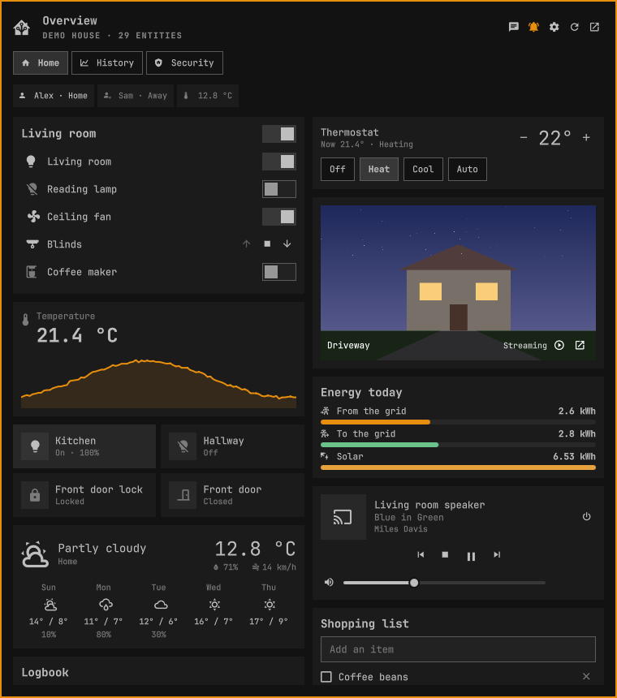

# HA Overview

Your Home Assistant dashboards in the [Omarchy](https://omarchy.org) bar. Click
the icon and the dashboard drops down — drawn natively, card by card, with
every switch, slider, thermostat, alarm keypad and camera working live.



- **Your real dashboards.** It reads the same Lovelace config the HA frontend
  does, so the cards, titles, views and order are the ones you built. The
  auto-generated Overview (before you ever "took control") is rebuilt from your
  areas, the way HA does it.
- **A dropdown of dashboards.** Pick which ones it lists in the settings; tabs
  switch between a dashboard's views.
- **Every control.** Lights (brightness, colour temperature, colour, effects),
  switches, fans, covers (position, tilt), climate (modes, presets, ranges),
  media players (transport, volume, source), locks, alarm panels (with keypad),
  vacuums, valves, selects, numbers, text, scenes, scripts, buttons, updates,
  timers, counters and to-do lists. Tap any entity for its full controls.
- **Live.** State changes arrive over Home Assistant's websocket the moment
  they happen — no polling.
- **Cameras.** Snapshots refresh while the panel is open; the play button turns
  a card live in place, and a camera's own page starts live. HLS where the
  camera has it, HA's MJPEG proxy where it does not (Frigate cameras, say). The
  window button plays it in mpv instead.
- **History and maps.** history-graph, statistics-graph and graph sensor cards
  draw their charts; every entity's page has its last 24 hours. Map cards show
  people and zones on OpenStreetMap, through Home Assistant's own tile proxy —
  dark grey in a dark theme; the wheel zooms, and a person's name flies the map
  to them.
  Logbook, energy, statistic and to-do list cards are drawn too.
- **In the bar.** Pin any entity and its icon sits beside the house while it is
  on — an armed alarm, an open garage. With nothing pinned, the alarm panels
  are shown. A dot means Home Assistant has notifications waiting.
- **Notifications.** Home Assistant's own notifications arrive as desktop
  toasts, an alarm going off is an urgent one, and any entity can notify you
  whenever it changes.
- **Assist.** Type to Home Assistant's conversation agent from the panel (`a`)
  or from a keybinding, in the language of the pipeline you pick.

## Install

```bash
omarchy plugin add https://github.com/duarte-gui/homeassistant-omarchy
```

or from a clone:

```bash
git clone https://github.com/duarte-gui/homeassistant-omarchy
cd homeassistant-omarchy
./install.sh
```

Then right click the bar icon (or press `s` in the panel) and fill in:

1. **Home Assistant address** — an IP such as `192.168.1.10`, a hostname such
   as `homeassistant.local`, or a full URL. A bare IP or hostname gets port 8123.
2. **Access token** — in Home Assistant, open your profile → *Security* →
   *Long-lived access tokens* → *Create token*, and paste it. It is saved in
   `~/.config/ha-overview/token`, readable only by you (mode `0600` in a `0700`
   folder), not in `shell.json`.
3. **Dashboards in the dropdown** — every dashboard is listed until you untick
   one.

Requirements: `python3` (standard library only) for the websocket bridge,
`python-gobject` for notifications, `qt6-multimedia-ffmpeg` for live cameras
(all three ship with Omarchy), and
`mpv` if you want camera streams in a window of their own.

To remove it, `omarchy plugin remove io.github.duarte-gui.ha-overview`, or
`./install.sh --uninstall` from the clone. Either disables the widget first.
`./install.sh --uninstall` also deletes the saved token; after
`omarchy plugin remove`, delete it yourself with `rm -r ~/.config/ha-overview`.
You may also want to revoke the token in Home Assistant (profile → *Security*).

## Using it

| Where | What |
|---|---|
| Left click | drop the dashboard down |
| Right click | settings |
| Middle click | open Home Assistant in the browser, on the same view |
| Tap an entity | its tap action — usually its full controls |
| Right click an entity | always its full controls |
| Tile icon | toggle |
| Middle click a camera | live stream in mpv |
| Middle click a pinned icon in the bar | toggle that entity |
| Wheel / drag on a map | zoom / pan |

Keys in the panel: `1`–`9` views, `←`/`→` previous/next view, `d`/`D` next/previous
dashboard, `↑`/`↓` scroll, `a` Assist, `n` notifications, `s` settings, `r` refresh,
`o` open in the browser, `Esc` back/close.

On an entity's page, **Show in the bar** pins it beside the bar icon and
**Notify me on changes** sends a toast whenever its state changes.

### From a keybinding or a script

```bash
omarchy-shell hass toggle                          # the panel
omarchy-shell hass dashboard map                   # a dashboard, by url_path or title
omarchy-shell hass view alarm                      # a view, by path, title or number
omarchy-shell hass toggleEntity light.desk         # an entity id or friendly name
omarchy-shell hass call scene.turn_on scene.movie  # any service
omarchy-shell hass state "Living room temperature"
omarchy-shell hass moreInfo climate.office         # open that entity's controls
omarchy-shell hass assist "turn off the kitchen lights"   # the answer comes as a toast
omarchy-shell hass pin binary_sensor.garage_door   # pin to the bar, or unpin
omarchy-shell hass watch lock.front_door           # notify on its changes, or stop
omarchy-shell hass notifications                   # show HA's notifications; prints how many
omarchy-shell hass chat | last                     # the Assist page | the last notified entity
omarchy-shell hass dashboards | status | refresh | setup | browser
```

`hypr/ha-overview-bindings.lua` has ready-made Hyprland bindings
(`SUPER+ALT+H` opens the panel), and `hypr/ha-overview.lua` floats and pins the
camera stream window.

## Settings

Everything lives on the widget's entry in `~/.config/omarchy/shell.json`,
except the access token, which is kept apart (see below):

| Key | Default | |
|---|---|---|
| `haUrl` | `http://homeassistant.local:8123` | where Home Assistant is |
| `dashboards` | all | url_paths listed in the dropdown |
| `columns` | `2` | card columns |
| `panelWidth` | `760` | dropdown width in px |
| `panelHeight` | `860` | height before it scrolls |
| `cameraRefreshSec` | `10` | camera snapshot refresh, only while open |
| `notifyErrors` | `true` | toast a failed action when the panel is closed |
| `barEntities` | alarm panels | entities pinned beside the bar icon |
| `notifyEntities` | | entities that toast whenever they change |
| `notifyAlarms` | `true` | an urgent toast when an alarm panel is triggered |
| `notifyHa` | `true` | Home Assistant's own notifications as toasts |
| `mapTiles` | `true` | OpenStreetMap tiles on map cards, via HA's tile proxy |
| `mapTheme` | `auto` | map colours: `auto` follows the theme, or `dark`, `light` |
| `assistPipeline` | HA's preferred | the Assist pipeline, which sets its language |

`dashboard` and `view` are written back by the panel so it reopens where you
left it.

## How it works

`bridge.py` keeps one websocket open to Home Assistant — the dashboards
themselves (`lovelace/config`), the registries and the stream of state changes
are only served there, and the shell has no websocket module. It speaks the
protocol with the Python standard library and talks to the widget in JSON
lines. The access token reaches it on stdin, never in a command line, where any
local account could read it from `/proc`. The bridge also owns where the token
is kept: `~/.config/ha-overview/token`, written atomically with mode `0600` in a
`0700` directory, never following a symlink, and only read back when it is a
regular file of yours. `shell.json` is written by the shell with whatever
permissions it already has, so the token stays out of it; one left there by
version 0.2.2 or earlier is moved into the private file on the first start and
then removed from `shell.json`. Camera stream URLs reach mpv the same
way.

Everything else goes over that same socket too: history, statistics, the
logbook, energy, Assist, notifications. Pictures load from Home Assistant
directly — camera snapshots and streams through the camera proxy, map tiles
through HA's `map_tiles` proxy (2026.9 and later), which fetches them from
OpenStreetMap with the identifying User-Agent OSM requires. So the widget
talks to nobody but your Home Assistant.

Toasts go to `notify.py` as JSON on stdin, and it calls the notification
daemon over D-Bus itself, so what a notification says — which door opened —
never appears in a process's arguments either.

`Model.js` turns a dashboard into a list of blocks once, from its config alone;
every card then reads live state as it renders, so a state change re-renders
only the rows it touches.

Card types drawn natively: entities (with section, divider, attribute, weblink,
text, button and buttons rows, and the header toggle), tile (with its
features), button, glance, entity, sensor (with its graph), gauge, light,
thermostat, humidifier, media-control, alarm-panel, weather-forecast, markdown
(templates rendered by HA, live), picture-entity, picture-glance, picture,
heading, map, history-graph, statistics-graph, statistic, logbook, todo-list,
the energy cards (as today's totals), grid, vertical-stack, horizontal-stack,
conditional and sections views, plus `visibility` conditions and view badges.
Any other card — including custom ones — is shown as a list of the entities it
mentions, so nothing on a dashboard is out of reach.

## Development

```bash
./install.sh --watch      # re-sync on every save; the shell hot-reloads the QML
node Model.test.js        # the pure logic, no shell needed
python3 tools/mock-ha.py  # a demo house on 127.0.0.1:8124, no real devices
```

Point the widget at the mock (address `127.0.0.1:8124`, any token shaped
`aaa.bbb.ccc`) to try every control without touching a real house; its
`/mock/state` and `/mock/notify` endpoints fire state changes and
notifications from outside. `preview.png` is taken from it.

Imported `.js` files, and `.qml` files added since the shell started, are not
hot-reloaded: after either, run `omarchy restart shell`. `tools/gen-icons.py` regenerates `Icons.js`, the
`mdi:` name → Nerd Font codepoint table.

## License

MIT
